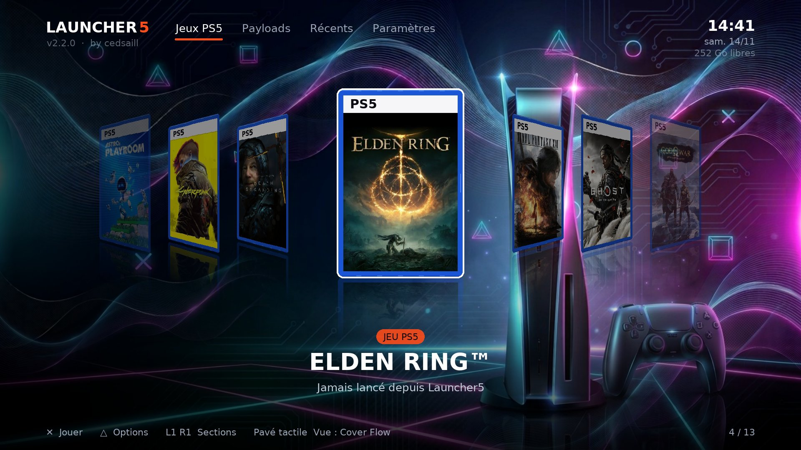
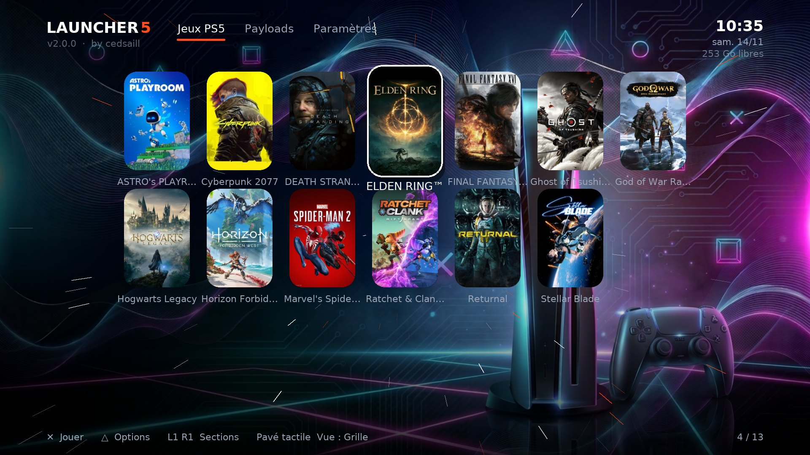
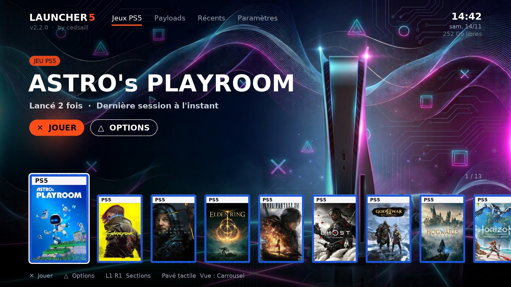
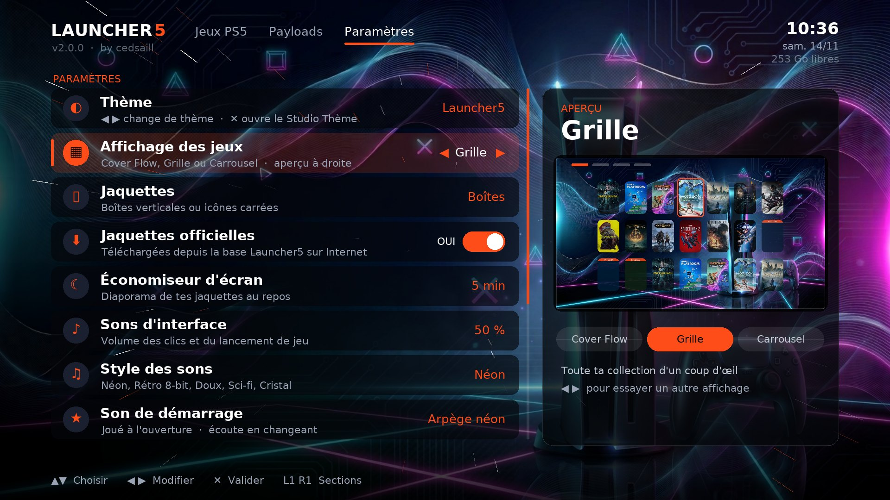
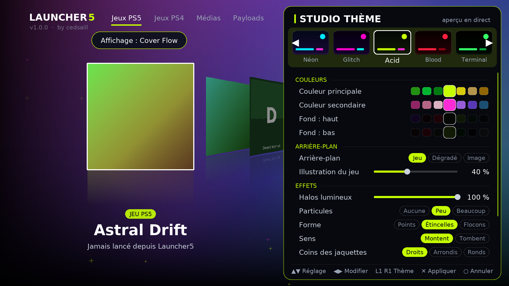

<p align="center"></p>

# Launcher5 — game loader pour PS5

**par cedsaill** · v2.1.0 · [English below](#english)

Launcher5 remplace la navigation dans tes jeux et homebrews par un vrai game loader :
jaquettes officielles, cover flow en 3D, thèmes animés, sons, dossiers, musique d'ambiance.



| Grille | Carrousel |
|---|---|
|  |  |

| Paramètres (avec aperçu) | Studio Thème |
|---|---|
|  |  |

## Nouveautés de la v2
- **Mise à jour automatique** : le launcher trouve tout seul la nouvelle version et l'installe
  (voir [Mises à jour](#mises-à-jour))
- **Jaquettes officielles** des jeux PS5, téléchargées toutes seules depuis la
  [base Launcher5](https://github.com/cedsaill3/Launcher5-covers) sur GitHub :
  ça marche même quand les serveurs Sony sont bloqués par DNS
- **Jaquettes boîtes** pour tous les autres jeux, fabriquées à partir de leur illustration
  (bandeau PS5 / PS4), ou ta propre jaquette dans `jaquettes/`
- **Menu Paramètres** complet, avec **aperçu en direct** de l'affichage choisi
- **Sons** : 5 styles d'interface (Néon, Rétro 8-bit, Doux, Sci-fi, Cristal) et 6 sons de démarrage
- **Masquer l'IP** à l'écran, pour les captures et les lives
- 22 thèmes et 7 fonds d'écran inclus, effets animés (grille, hyperespace, pluie),
  couleurs automatiques selon le jeu
- Économiseur d'écran : diaporama de tes fonds d'écran avec l'horloge ; temps de jeu, favoris

## Fonctions
- **3 affichages** : Cover Flow (perspective 3D avec reflets), Grille, Carrousel — au **pavé tactile**
- Sections : Jeux PS5, Jeux PS4, Médias, Homebrews, Émulateurs, Payloads, Récents, Mes dossiers
- **Studio Thème** à la manette : couleurs, fond (illustration du jeu, dégradé ou image perso),
  halos, particules, effets, horloge, musique
- Dossiers colorés, noms personnalisés, jeux masqués, retour automatique après un jeu
- **Multilingue automatique** selon la langue de la console : français, anglais, espagnol,
  allemand, italien, portugais — noms des jeux compris
- Tuile **Launcher5** ajoutée toute seule sur l'accueil de la PS5
- 60 images/s sur PS5

## Installation
1. PS5 jailbreakée avec un chargeur ELF actif (port 9021).
2. Télécharge `launcher5.elf` dans les [Releases](../../releases).
3. Envoie `launcher5.elf` au chargeur (port 9021).
4. La tuile Launcher5 apparaît sur l'accueil et le launcher s'ouvre.
   Après un redémarrage de la console, renvoie l'ELF.

Testé sur CFI-1216A, firmware 13.60.

## Mises à jour
Le launcher vérifie une fois par jour s'il existe une nouvelle version sur GitHub
(Paramètres › Mises à jour automatiques). Dans **Paramètres › Mettre à jour**, ✕ la télécharge,
vérifie son empreinte SHA-256 et l'installe : le launcher redémarre tout seul.

La nouvelle version est enregistrée sur la console :

```
/data/launcher5/launcher5.elf
```

> **Autoload** : si ta console lance automatiquement un ELF au démarrage (autoload de ton
> jailbreak, etaHEN…), fais-le pointer sur `/data/launcher5/launcher5.elf`. La PS5 démarrera
> ainsi toujours la dernière version, sans PC ni clé USB. Le fichier `launcher5.elf` que tu
> gardes sur ton PC ou ta clé USB, lui, n'est pas modifié.

## Manette
| Touche | Action |
|---|---|
| Pavé tactile | Cover Flow / Grille / Carrousel |
| L1 / R1 | sections |
| ✕ | jouer / ouvrir |
| △ | options (dossiers, renommer, masquer, thème…) |
| □ | déplacer |
| ○ | retour |

## Personnaliser
Dans `/data/launcher5` sur la PS5, par FTP :

| Dossier | Contenu |
|---|---|
| `fonds/` | images de fond |
| `musique/` | musiques d'ambiance (ogg, mp3, flac, wav, mod…) |
| `themes/` | thèmes (.json) |
| `jaquettes/` | jaquettes perso : `<ID du jeu>.jpg` ou `.png` (ex. `PPSA01234.jpg`) |

Le launcher recharge tout seul un menu, un thème ou une jaquette modifiés.

## Compiler
- PS5 : SDK [ps5-payload-dev](https://github.com/ps5-payload-dev/sdk), dans Ubuntu (WSL) :
  `cd launcher && make` → `launcher/build/launcher5.elf`
- Version PC de test : `make -f Makefile.pc && ./launcher5` (SDL2, SDL2_ttf, SDL2_image, SDL2_mixer, jansson)

## Licence
Launcher5 © 2026 cedsaill. Les chargeurs ELF (`launcher/gpl/`) et la méthode
d'installation de la tuile viennent des projets de John Törnblom (GPL v3) : `launcher5.elf`
est distribué sous **GPL v3** (voir [launcher/COPYING](launcher/COPYING)).
Polices DejaVu : licence libre. Les jaquettes appartiennent à leurs éditeurs.

---

## English

**Launcher5** is a game loader for jailbroken PS5 consoles, by **cedsaill**: official covers,
Cover Flow with 3D perspective and reflections, cover grid, carousel, animated themes,
interface sounds, folders, background music. The interface follows the console language
(French, English, Spanish, German, Italian, Portuguese).

**New in v2:** official PS5 covers downloaded automatically from the
[Launcher5 cover database](https://github.com/cedsaill3/Launcher5-covers) on GitHub (works even
when Sony servers are blocked by DNS) · box covers for every other game · full Settings menu with
live layout preview · 5 interface sound styles and 6 startup sounds · hide IP option ·
22 themes, 7 bundled wallpapers and animated effects.

**Install:** download `launcher5.elf` from [Releases](../../releases) and send
`launcher5.elf` to your ELF loader (port 9021). A *Launcher5* tile is added to the PS5 home screen.

**Updates:** the launcher checks GitHub once a day; *Settings › Update* downloads the new version,
verifies its SHA-256 and installs it. It is saved on the console as `/data/launcher5/launcher5.elf`:
**point your autoload to that file** so the console always starts the latest version.

**Controls:** touchpad = Cover Flow / Grid / Carousel · L1/R1 = sections · ✕ play · △ options ·
□ move · ○ back.

**Custom covers:** put `<game ID>.jpg` in `/data/launcher5/jaquettes/` over FTP.

**License:** © 2026 cedsaill. Bundled ELF loaders by John Törnblom (GPL v3), so `launcher5.elf`
is distributed under GPL v3. Cover art belongs to its publishers.
