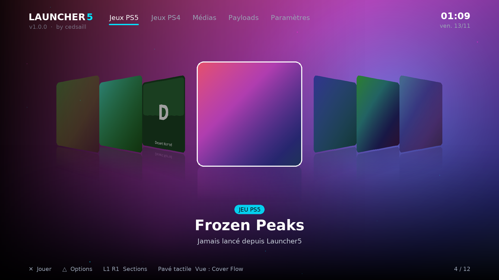
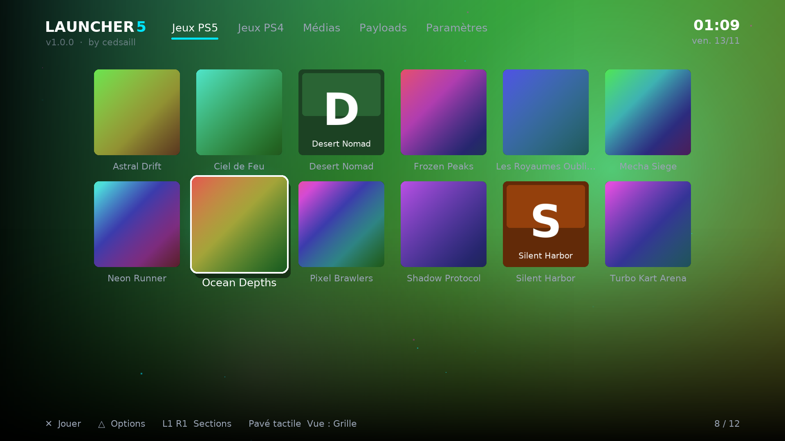

# Launcher5 — game loader pour PS5

**par cedsaill** · v1.0.0 · [English below](#english)

Launcher5 remplace la navigation dans tes jeux et homebrews par un vrai game loader :
mur de jaquettes, cover flow en 3D, thèmes animés, dossiers, musique d'ambiance.

| Grille | Studio Thème |
|---|---|
|  |  |

## Fonctions
- **3 affichages** : Cover Flow (perspective 3D avec reflets), Grille, Carrousel — au **pavé tactile**
- Sections : Jeux PS5, Jeux PS4, Médias, Homebrews, Émulateurs, Payloads, Récents, Mes dossiers
- **Studio Thème** à la manette : 17 thèmes (Glitch, Acid, Blood, Terminal, Néon, Synthwave…),
  couleurs, fond (illustration du jeu, dégradé ou image perso), halos, particules, horloge, musique
- Dossiers colorés, noms personnalisés, jeux masqués, retour automatique après un jeu
- **Multilingue automatique** selon la langue de la console : français, anglais, espagnol,
  allemand, italien, portugais — noms des jeux compris
- Tuile **Launcher5** ajoutée toute seule sur l'accueil de la PS5
- 60 images/s sur PS5

## Installation
1. PS5 jailbreakée avec un chargeur ELF actif (port 9021).
2. Télécharge `launcher5.elf` dans les [Releases](../../releases).
3. Envoie `launcher5.elf` au chargeur (port 9021).
4. La tuile Launcher5 apparaît sur l'accueil et le launcher s'ouvre.
   Après un redémarrage de la console, renvoie l'ELF.

Testé sur CFI-1216A, firmware 13.60.

## Manette
| Touche | Action |
|---|---|
| Pavé tactile | Cover Flow / Grille / Carrousel |
| L1 / R1 | sections |
| ✕ | jouer / ouvrir |
| △ | options (dossiers, renommer, masquer, thème…) |
| □ | déplacer |
| ○ | retour |

## Personnaliser
Dans `/data/launcher5` sur la PS5 : `fonds/` (images), `musique/` (ogg, mp3, flac, wav, mod…),
`themes/` (.json) — par FTP. Le launcher recharge tout seul un menu ou un thème modifié.

## Compiler
- PS5 : SDK [ps5-payload-dev](https://github.com/ps5-payload-dev/sdk), dans Ubuntu (WSL) :
  `cd launcher && make` → `launcher/build/launcher5.elf`
- Version PC de test : `make -f Makefile.pc && ./launcher5` (SDL2, SDL2_ttf, SDL2_image, SDL2_mixer, jansson)

## Licence
Launcher5 © 2026 cedsaill. Les chargeurs ELF (`launcher/gpl/`) et la méthode
d'installation de la tuile viennent des projets de John Törnblom (GPL v3) : `launcher5.elf`
est distribué sous **GPL v3** (voir [launcher/COPYING](launcher/COPYING)).
Polices DejaVu : licence libre.

---

## English

**Launcher5** is a game loader for jailbroken PS5 consoles, by **cedsaill**: Cover Flow with 3D
perspective and reflections, cover grid, carousel, animated themes, folders, background music.
The interface follows the console language (French, English, Spanish, German, Italian, Portuguese).

**Install:** download `launcher5.elf` from [Releases](../../releases) and send
`launcher5.elf` to your ELF loader (port 9021). A *Launcher5* tile is added to the PS5 home screen.

**Controls:** touchpad = Cover Flow / Grid / Carousel · L1/R1 = sections · ✕ play · △ options ·
□ move · ○ back.

**License:** © 2026 cedsaill. Bundled ELF loaders by John Törnblom (GPL v3), so `launcher5.elf`
is distributed under GPL v3.
