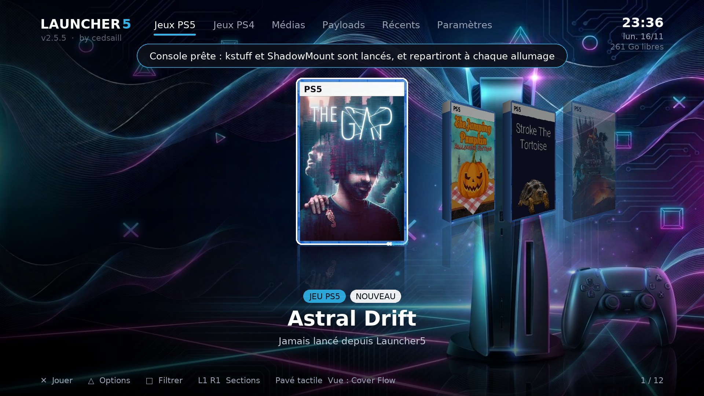
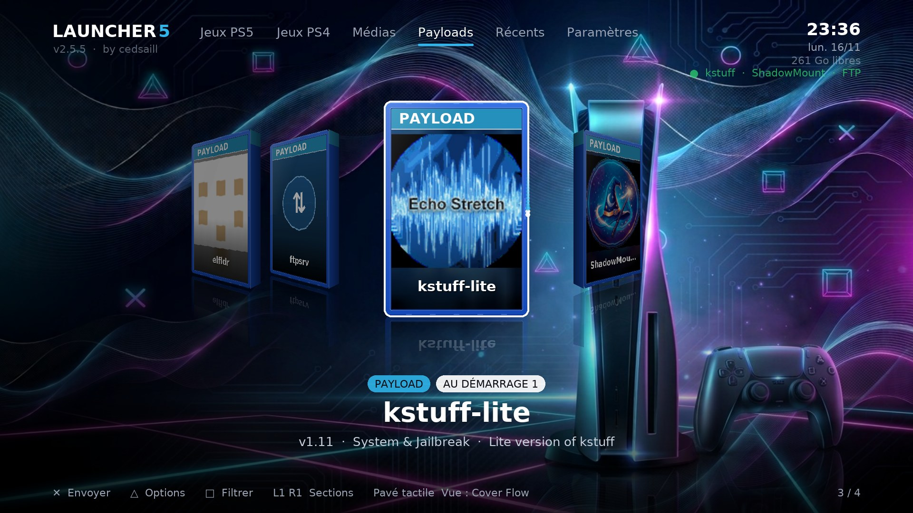
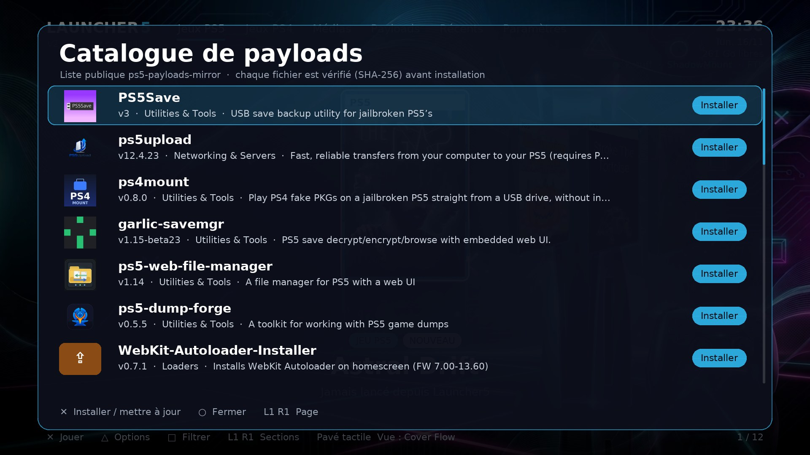
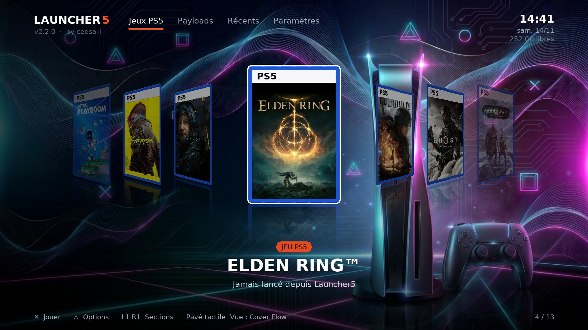
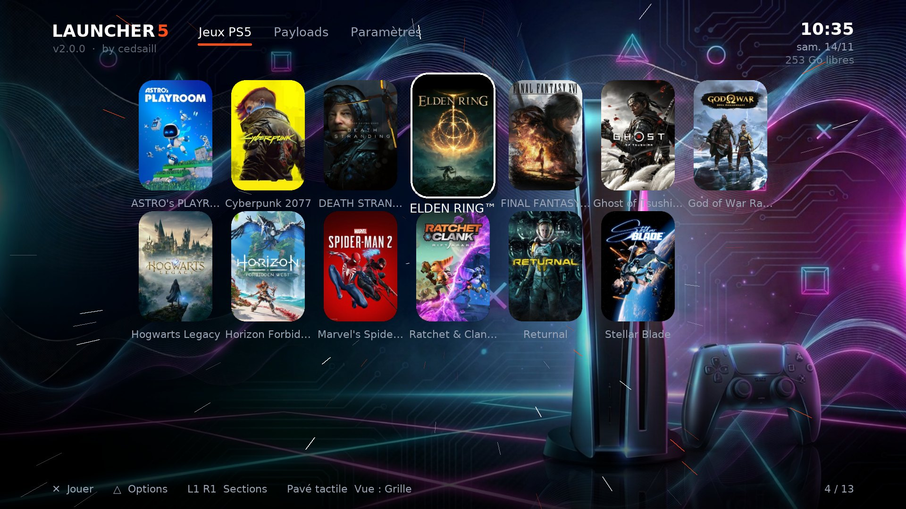
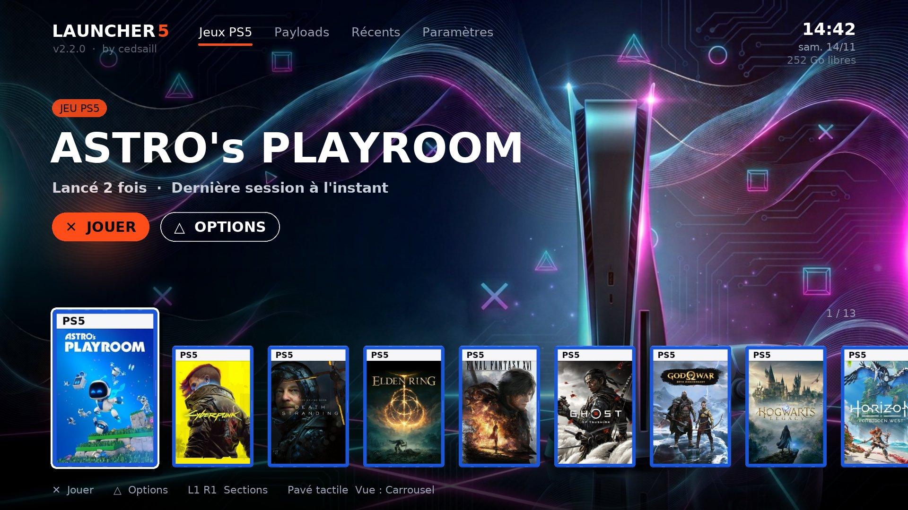
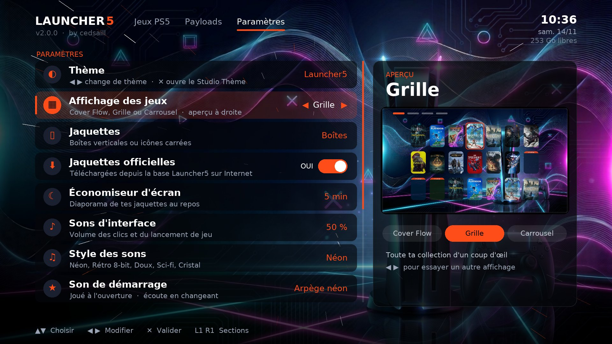
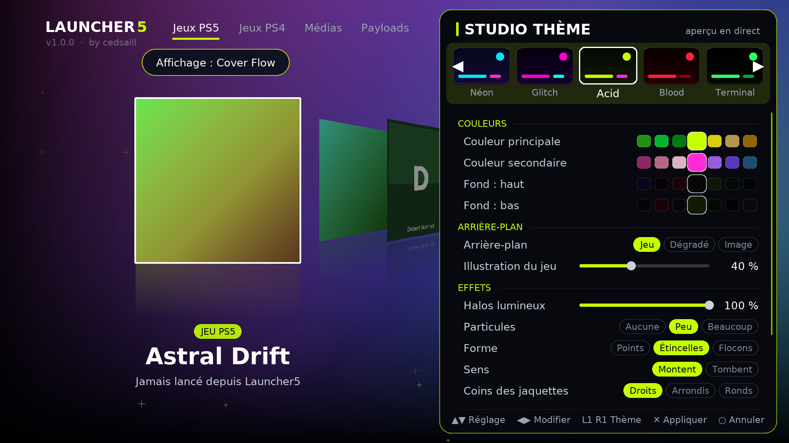

<p align="center"></p>

# Launcher5 — game loader pour PS5

**par cedsaill** · v2.5.11 · [English below](#english)

**Tu lances Launcher5, tu joues.** Tout est automatique : au premier lancement, il installe
kstuff et ShadowMount et s'ajoute au démarrage de la console. À chaque allumage, tout est
prêt et le launcher s'ouvre sur tes jeux.



| Payloads | Catalogue de payloads |
|---|---|
|  |  |



| Grille | Carrousel |
|---|---|
|  |  |

| Paramètres (avec aperçu) | Studio Thème |
|---|---|
|  |  |

## Fonctions
- **Automatique** : kstuff et ShadowMount installés et lancés à chaque allumage, `autoload.txt`
  créé ou complété (l'ancien est sauvegardé), jeux prêts à l'ouverture
- **État de la console** (Paramètres) : kstuff, ShadowMount et démarrage vérifiés d'un coup d'œil,
  **✕ Tout réparer** remet tout en place
- **3 affichages** au pavé tactile : Cover Flow, Grille, Carrousel
- **Jaquettes officielles** des jeux PS5, téléchargées toutes seules depuis la
  [base Launcher5](https://github.com/cedsaill3/Launcher5-covers) (marche même quand Sony est bloqué par DNS) ;
  boîtiers PS5 / PS4 pour les autres jeux, homebrews en rouge, ou ta jaquette dans `jaquettes/` ;
  tes propres images de boîtier dans `boitiers/` (`ps5.png`, `ps4.png`, zone de la jaquette transparente)
- Sections : Jeux PS5, Jeux PS4, Médias, Homebrews, Émulateurs, Payloads, Récents, Mes dossiers
- **Section Payloads** : catalogue avec mises à jour, liste « Au démarrage », payloads actifs
  affichés en haut à droite, payloads noyau envoyés seulement au démarrage et jamais deux fois
- Les jeux installés ou montés (PKG, FPKG) apparaissent tout seuls, même launcher ouvert
- **Studio Thème** à la manette : 24 thèmes dont **Loader GX** (interface claire façon USB Loader GX) et **Rebug** (interface façon XMB), 7 fonds d'écran, couleurs, effets animés, particules,
  style de boîtier, musique d'ambiance
- Sons d'interface (5 styles) et sons de démarrage
- **Menu rapide** (OPTIONS) : catalogue de payloads, aide, relancer, vider le cache des jaquettes
- **Mise à jour automatique** depuis GitHub
- Dossiers, favoris, noms perso, jeux masqués, temps de jeu, économiseur d'écran, masquer l'IP
- Français, anglais, espagnol, allemand, italien, portugais selon la langue de la console
- Tuile **Launcher5** sur l'accueil de la PS5, 60 images/s

## Installation
**Nouvelle installation**
1. PS5 jailbreakée avec un chargeur ELF actif (port 9021).
2. Télécharge `launcher5.elf` dans les [Releases](../../releases) et envoie-le au port 9021.
3. Le launcher installe sa tuile **Launcher5** sur l'accueil et s'ouvre.
4. Au premier lancement, il installe kstuff et ShadowMount et s'ajoute au démarrage de la
   console (`autoload.txt`). Si ton `autoload.txt` contient déjà tes payloads, il te demande
   avant de le remplacer ; l'ancien fichier est toujours sauvegardé.
5. Ensuite, à chaque allumage, tout démarre seul : tu ouvres la tuile et tu joues.

**Tu as déjà une version précédente**
- Accepte la mise à jour proposée dans le launcher, ou envoie le nouveau `launcher5.elf` au port 9021.
- Ton `autoload.txt` n'est pas modifié, tes réglages, thèmes, favoris et dossiers sont conservés.

Pour revenir à ton ancien `autoload.txt` : **Paramètres › Démarrage de Launcher5 › Manuel**.

**Désinstaller** : **Paramètres › Désinstaller Launcher5** remet ton `autoload.txt` d'origine et
retire la tuile (en gardant tes réglages ou en effaçant tout). Redémarre ensuite la console :
la tuile disparaît de l'accueil.

Testé sur CFI-1216A, firmware 13.60.

## Mises à jour
Le launcher vérifie une fois par jour s'il existe une nouvelle version sur GitHub
(Paramètres › Mises à jour automatiques). Dans **Paramètres › Mettre à jour**, ✕ la télécharge,
vérifie son empreinte SHA-256 et l'installe : le launcher redémarre tout seul.

La nouvelle version est enregistrée sur la console :

```
/data/launcher5/launcher5.elf
```

> **Autoload** : en mode autoloader, la copie de `ps5_autoloader` est tenue à jour toute seule.
> Si un autre outil lance Launcher5 au démarrage, fais-le pointer sur
> `/data/launcher5/launcher5.elf`. Le fichier `launcher5.elf` que tu gardes sur ton PC ou ta
> clé USB, lui, n'est pas modifié.

## Manette
| Touche | Action |
|---|---|
| Pavé tactile | Cover Flow / Grille / Carrousel |
| L1 / R1 | sections |
| ✕ | jouer / ouvrir |
| △ | options (dossiers, renommer, masquer, thème…) |
| □ | déplacer |
| OPTIONS | menu rapide (catalogue de payloads, aide, relancer, vider le cache des jaquettes) |
| ○ | retour |

## Personnaliser
Dans `/data/launcher5` sur la PS5, par FTP :

| Dossier | Contenu |
|---|---|
| `fonds/` | images de fond |
| `musique/` | musiques d'ambiance (ogg, mp3, flac, wav, mod…) |
| `themes/` | thèmes (.json) |
| `jaquettes/` | jaquettes perso : `<ID du jeu>.jpg` ou `.png` (ex. `PPSA01234.jpg`) |
| `/data/payloads/` | tes payloads (.elf) ; une image du même nom devient son icône |

Le launcher recharge tout seul un menu, un thème ou une jaquette modifiés.

## Compiler
- PS5 : SDK [ps5-payload-dev](https://github.com/ps5-payload-dev/sdk), dans Ubuntu (WSL) :
  `cd launcher && make` → `launcher/build/launcher5.elf`
- Version PC de test : `make -f Makefile.pc && ./launcher5` (SDL2, SDL2_ttf, SDL2_image, SDL2_mixer, jansson)

## Licence
Launcher5 © 2026 cedsaill. Les chargeurs ELF (`launcher/gpl/`) et la méthode
d'installation de la tuile viennent des projets de John Törnblom (GPL v3) : `launcher5.elf`
est distribué sous **GPL v3** (voir [launcher/COPYING](launcher/COPYING)).
Polices DejaVu : licence libre. Les jaquettes appartiennent à leurs éditeurs.
Les payloads ne sont pas inclus : ils sont téléchargés depuis leurs sources
([kstuff-lite](https://github.com/EchoStretch/kstuff-lite), [ShadowMountPlus](https://github.com/drakmor/ShadowMountPlus),
[ps5-payloads-mirror](https://github.com/itsPLK/ps5-payloads-mirror))
et restent la propriété de leurs auteurs.

---

## English

**Launcher5** is a game loader for jailbroken PS5 consoles, by **cedsaill**.
**Launch it and play:** on first launch it installs kstuff and ShadowMount and adds itself to the
console startup. At every boot everything is ready and the launcher opens on your games.
Official covers, Cover Flow, grid, carousel, animated themes, sounds, folders, music. The interface
follows the console language (French, English, Spanish, German, Italian, Portuguese).

**Install:** download `launcher5.elf` from [Releases](../../releases) and send
`launcher5.elf` to your ELF loader (port 9021). A *Launcher5* tile is added to the PS5 home screen.
That's it: you can play. Your previous `autoload.txt` is kept and backed up
(*Settings › Launcher5 startup › Manual* restores it). If something is missing,
*Settings › Console status › ✕ Fix everything* sets it all up again.
Coming from a previous version: accept the update offered in the launcher (or send the new
`launcher5.elf`); your `autoload.txt` and settings are kept.

**Uninstall:** *Settings › Uninstall Launcher5* restores your original `autoload.txt` and removes
the tile; restart the console and the tile is gone from the home screen.

**Updates:** the launcher checks GitHub once a day; *Settings › Update* downloads the new version,
verifies its SHA-256 and installs it. It is saved on the console as `/data/launcher5/launcher5.elf`:
**point your autoload to that file** so the console always starts the latest version.

**Controls:** touchpad = Cover Flow / Grid / Carousel · L1/R1 = sections · ✕ play · △ options ·
□ move · OPTIONS quick menu · ○ back.

**Custom covers:** put `<game ID>.jpg` in `/data/launcher5/jaquettes/` over FTP.

**License:** © 2026 cedsaill. Bundled ELF loaders by John Törnblom (GPL v3), so `launcher5.elf`
is distributed under GPL v3. Cover art belongs to its publishers. Payloads are not bundled: they
are downloaded from their own sources and belong to their authors.
